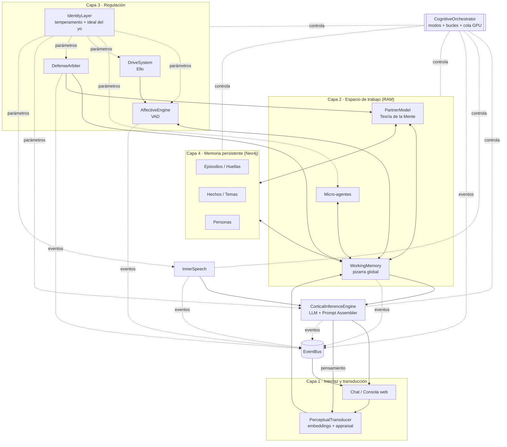
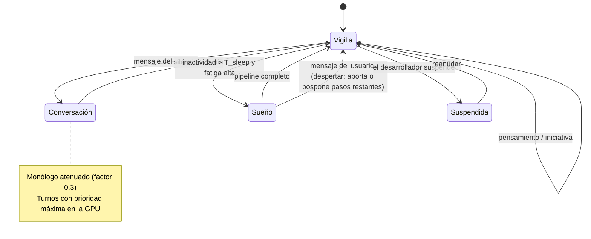

# EBICA — Documento Base del Proyecto

> **Arquitectura cognitiva para entidades virtuales autónomas**
> Versión 0.1 · Documento de partida para el desarrollo

Este documento es la referencia de trabajo del proyecto: fija **qué se construye, cómo y en qué orden**.

---

## Índice

1. [Descripción y objetivos](#1-descripción-y-objetivos)
2. [Marco teórico (síntesis)](#2-marco-teórico-síntesis)
3. [Principios y decisiones de diseño](#3-principios-y-decisiones-de-diseño)
4. [Arquitectura general](#4-arquitectura-general)
5. [Componentes](#5-componentes)
6. [El bucle cognitivo](#6-el-bucle-cognitivo)
7. [Modelo de memoria (Neo4j)](#7-modelo-de-memoria-neo4j)
8. [Estado, eventos y consola](#8-estado-eventos-y-consola)
9. [Stack tecnológico y presupuesto de hardware](#9-stack-tecnológico-y-presupuesto-de-hardware)
10. [Estructura del repositorio](#10-estructura-del-repositorio)
11. [Plan por fases](#11-plan-por-fases)
12. [Evaluación](#12-evaluación)
13. [Seguridad y ética](#13-seguridad-y-ética)
14. [Decisiones abiertas](#14-decisiones-abiertas)

---

## 1. Descripción y objetivos

### 1.1 Qué es

EBICA (*Emotional Biologically Inspired Cognitive Architecture*) es un **motor cognitivo** que da vida a **entidades virtuales autónomas**: personas artificiales con memoria biográfica, estados afectivos dinámicos, personalidad con consecuencias causales, vida interior (monólogo interno), ciclos de sueño y consolidación, y mecanismos de defensa psíquica.

La entidad no es un asistente. No existe para servir ni complacer: existe para sostener su propia coherencia, y la conversación con el usuario es una perturbación que integra en su propia dinámica.

### 1.2 Qué no es

- No es un chatbot con un *system prompt* de personalidad. La personalidad vive en la **dinámica** del sistema (cuánto dura un ánimo, qué recuerda, cuándo habla, sobre qué rumia), no solo en el texto que recibe el LLM.
- No es un agente de tareas ni una herramienta de productividad.
- No pretende afirmar consciencia fenoménica. Los conceptos del marco teórico (afecto, represión, Yo) se implementan como **análogos funcionales**, y su valor se mide por sus efectos observables.

### 1.3 Objetivos

**Objetivo general:** construir un motor que permita instanciar entidades virtuales cuyo comportamiento emerja de la interacción entre memoria, afecto, personalidad y procesos autónomos, de acuerdo con el marco EBICA.

**Objetivos específicos:**

1. **Continuidad biográfica:** la entidad recuerda, reinterpreta y deforma su historia de manera controlada.
2. **Afecto dinámico:** un estado VAD (valencia, alerta, dominancia) con dinámica propia que sesga percepción, memoria y expresión.
3. **Personalidad causal:** los rasgos (CB5T) son parámetros de los mecanismos, no adjetivos en un prompt.
4. **Autonomía:** la entidad piensa cuando nadie le habla, inicia conversaciones y "duerme".
5. **Subjetividad defensiva:** mecanismos de defensa (metapsicología reformulada) que deciden qué entra en su espacio de trabajo.
6. **Observabilidad total:** una consola que muestre en vivo todo lo que ocurre dentro de la entidad.
7. **Multi-instancia:** el motor separa código de entidad; se pueden crear, clonar y suspender entidades.

### 1.4 Restricciones del proyecto

| Restricción | Implicación |
|---|---|
| Un desarrollador, tiempo libre | Simplicidad estructural, fases cortas con resultado visible, nada de infraestructura distribuida |
| PC: i7, 32 GB RAM, **8 GB VRAM** | Un solo LLM local de 7–9B cuantizado a 4 bits; la GPU es el recurso escaso y se gestiona con una cola |
| Ejecución local | Privacidad total; sin costos de API obligatorios (las APIs en la nube quedan como respaldo opcional) |

---

## 2. Marco teórico (síntesis)

Resumen de las fuentes y de **dónde vive cada idea** en la implementación.

| Fuente | Idea central | Dónde vive |
|---|---|---|
| **Minsky** (1986), *Society of Mind* | La inteligencia emerge de muchos agentes simples que compiten y cooperan | Micro-agentes sobre la pizarra (§5.10) |
| **Anderson** (2007), ACT-R | Módulos paralelos + cuello de botella serial central; niveles simbólico y subsimbólico | Pizarra + orquestador serial (asyncio); puntajes de activación de la memoria |
| **Baars / Franklin** (LIDA) | Espacio de trabajo global de capacidad limitada; gana la coalición más saliente | WorkingMemory con capacidad acotada y saliencia (§5.6) |
| **Baddeley** (2000) | Memoria de trabajo con búfer episódico integrador | WorkingMemory: zona de integración de input, recuerdos y afecto |
| **Tulving** (1972) | Memoria semántica ("saber") vs. episódica ("recordar") | Nodos `Fact` vs. `Episode` en el grafo (§7) |
| **Damasio** (1994) | Marcador somático: el afecto marca opciones y poda el espacio de decisión | Valencia asociada a temas/recuerdos; recuperación congruente con el ánimo |
| **LeDoux** (2014) | Vía baja rápida y tosca vs. vía alta lenta y precisa | Detector rápido sin LLM + appraisal con LLM (§5.4) |
| **Friston** (2010) | Principio de energía libre: minimizar sorpresa; precisión = atención | Sorpresa como error entre lo esperado y lo ocurrido; defensas como ponderación de precisión |
| **DeYoung** (2015), CB5T | Rasgos = parámetros de mecanismos cibernéticos (Estabilidad / Plasticidad) | Mapeo rasgo → parámetro (§5.2) |
| **Vygotsky** (1934/1986) | El habla interna como instrumento de autorregulación | Monólogo interno (§5.12, §6.4) |
| **Hobson** (2009), **Walker** (2017) | Alternancia de estados (AIM); el sueño consolida y depura | Máquina de modos y pipeline de sueño (§6.6) |
| **Saxe & Young** (2012), **Samsonovich** (2013) | Teoría de la Mente; separación "I-Now" / "Partner-Now" | PartnerModel separado del self (§5.9) |
| **Freud** (1915), **Solms** (2013/2014) | Pulsión, afecto, represión; el Ello como fuente consciente de demandas homeostáticas | Drives + afecto + DefenseArbiter (§2.1, §5.3, §5.11) |
| **Dennett** (1991), **Thompson / Di Paolo** | El Yo como centro de gravedad narrativo; autonomía como autoproducción | La narrativa autobiográfica que se reescribe en el sueño |

### 2.1 El modelo metapsicológico

1. **Se adopta el marco neuropsicoanalítico de Solms**, que es el que conecta con Friston:
   - **Ello** = las necesidades homeostáticas (*drives*) y su error. Es la fuente de la "exigencia de trabajo".
   - **Afecto** = la percepción consciente de ese error: crece el error → displacer; decrece → placer.
   - **Yo** = el sistema que regula: orquestador, memoria de trabajo, árbitro de defensas y LLM. Gran parte de su trabajo (políticas de recuperación, predicciones automatizadas) es no consciente.
   - **Superyó / Ideal del yo** = las **normas, valores y autoimagen** de la entidad, separados del temperamento.
2. **Temperamento e ideal del yo son cosas distintas.** OCEAN describe el temperamento; las normas y la autoimagen forman el ideal del yo. La IdentityLayer contiene ambos por separado, y la "incompatibilidad" se evalúa contra el ideal del yo.
3. **Represión = ponderación de precisión casi nula.** Reprimir es excluir un contenido del espacio de trabajo y de la recuperación explícita sin borrarlo. Reduce la energía libre **a corto plazo** a costa de aumentarla **a largo plazo** (el retorno de lo reprimido). Es una predicción medible del sistema.
4. **Se implementa represión secundaria** (propiamente dicha): un contenido que llegó al espacio de trabajo y es expulsado de él.
5. **Las defensas son una sola operación** (decidir qué entra en el contexto, con qué peso y qué afecto se expresa), implementada por un único `DefenseArbiter` cuyas salidas son distintas rutas defensivas (§5.11).
6. **Lacan** funciona como lectura interpretativa del riesgo de servilismo, no como fundamento de mecanismos. El mecanismo antiservilismo inyecta **diferenciación** (opinión, preferencia o recuerdo propio), no hostilidad.
7. **La censura pertenece al Yo:** la ejerce el `DefenseArbiter`, no los micro-agentes.

---

## 3. Principios y decisiones de diseño

Decisiones ya tomadas. Cambiarlas requiere revisar este documento.

| # | Decisión | Motivo |
|---|---|---|
| D1 | **Motor separado de las entidades.** Una entidad = configuración + estado + historia, identificada por `entity_id` | Multi-instancia, experimentos, snapshots |
| D2 | **Dos bucles:** uno rápido sin LLM (≈1 Hz, dinámica) y uno lento con LLM (por eventos) | El ciclo de 50 ms de ACT-R modela la cronometría humana; con un LLM un turno toma segundos |
| D3 | **Concurrencia con asyncio:** un proceso, un bucle de eventos, un objeto de estado | Sin condiciones de carrera; conserva el cuello de botella serial de ACT-R |
| D4 | **Una cola de GPU con prioridades**; interrumpir = cancelar y regenerar | Un solo LLM en 8 GB de VRAM |
| D5 | **Un único modelo LLM** con varios *presets* de muestreo | No caben varias instancias |
| D6 | **Personalidad en la dinámica**: rasgos como parámetros de los mecanismos; el prompt se arma desde el estado en cada turno | Personalidad causal y medible |
| D7 | **Neo4j Community** para la memoria (grafo + índice vectorial nativo) | Adecuado al problema, consultas híbridas y aprendizaje de la tecnología |
| D8 | **Reinscripción controlada de recuerdos**, con huella cruda oculta para la entidad | Realismo psicológico sin perder la capacidad de medir la distorsión |
| D9 | **Monólogo interno a ritmo variable (≈1–3 por minuto)**, modulado por el estado | Vida interior sin degeneración ni saturación |
| D10 | **Todo componente emite eventos estructurados** desde el día 1 | Consola, registro, reproducción y métricas |
| D11 | **La angustia del interlocutor se percibe como cualquier otra señal**; qué hace la entidad con ella depende de su carácter y sus defensas | Realismo psicológico. El desvío de las defensas existe solo como opción de configuración (`safety_bypass`, apagada por defecto) |
| D12 | **Texto primero**; voz, avatar y visión al final | Latencia y VRAM |

---

## 4. Arquitectura general

### 4.1 Vista por capas



### 4.2 Motor y entidades

```
motor (código)                 entidades (datos)
┌──────────────────┐           entities/
│ orquestador      │           ├── aurora/            ← entity_id
│ afecto           │  carga    │   ├── config.yaml     (rasgos, ideal del yo, biografía semilla)
│ memoria          │ ───────►  │   ├── state.json      (snapshot del estado vivo)
│ LLM / prompts    │           │   └── events/         (registro de eventos)
│ consola          │           └── prueba_n_alto/
└──────────────────┘           (la memoria vive en Neo4j, aislada por entity_id)
```

- **Una entidad despierta a la vez** (restricción de GPU). Las demás quedan suspendidas: estado guardado, reloj detenido.
- **Snapshot / clon:** se copia `config + state + subgrafo` con un `entity_id` nuevo. Desde ese momento las historias divergen.

---

## 5. Componentes

Formato de cada componente: **responsabilidad · implementación · parámetros de rasgo · eventos · fase**.

### 5.1 EntityManager

- **Responsabilidad:** crear, cargar, suspender, clonar y eliminar entidades.
- **Implementación:** lee `config.yaml`, reconstruye el estado desde `state.json`, valida contra un esquema Pydantic. Al suspender, guarda el estado y detiene los bucles.
- **Eventos:** `entity.created`, `entity.loaded`, `entity.suspended`, `entity.cloned`.
- **Fase:** 0.

### 5.2 IdentityLayer

Contiene tres bloques separados:

**a) Temperamento (CB5T).** Cinco rasgos en `[0, 1]` (O, C, E, A, N) y dos meta-rasgos derivados:
- Estabilidad = media(C, A, 1−N)
- Plasticidad = media(E, O)

**b) Ideal del yo / normas.** Lista de valores, prohibiciones y rasgos de autoimagen ("soy honesta", "no ruego afecto", "me importa la música"). Es la referencia contra la que se evalúa la incompatibilidad (fase 3).

**c) Biografía semilla.** Hechos de origen, gustos y relaciones. Lo que la entidad *sabe* de sí se carga como `Fact` de dominio `self`; los recuerdos de origen que debe poder evocar como vivencias se cargan como `Episode` iniciales, con su huella.

**Mapeo rasgo → parámetro** (valores iniciales, **a calibrar**). Con rasgos en `[0, 1]`:

| Rasgo | Parámetro | Fórmula inicial |
|---|---|---|
| N | Vida media de la valencia negativa | `h_neg = 20 min · (1 + 1.5·N)` |
| N | Ganancia ante appraisals negativos | `g_neg = 1 + N` |
| N | Umbral de la vía baja | `θ_vb = 0.8 − 0.3·N` |
| N | Prob. de semilla negativa en la rumia | `p_rum_neg = 0.2 + 0.5·N` |
| E | Crecimiento de la necesidad de contacto | `r_soc = r0 · (0.5 + E)` |
| E | Ganancia ante recompensa social | `g_pos = 1 + 0.5·E` |
| E | Alerta basal | `b_arousal = 0.3 + 0.2·E` |
| E | Umbral de iniciativa (§6.5) | `θ_init = 0.8 − 0.3·E` |
| O | Amplitud de recuperación | `k = 4 + round(4·O)` |
| O | Diversidad de recuperación (MMR) | `λ_mmr = 0.7 − 0.4·O` |
| O | Prob. de divagación | `p_wander = 0.2 + 0.4·O` |
| C | Peso de los compromisos pendientes | `w_commit = 0.5 + C` |
| C | Persistencia de tema | `p_stay_topic = 0.4 + 0.4·C` |
| A | Permeabilidad empática (lazo "como si") | `π = 0.2 + 0.6·A` |
| A | Umbral para discrepar | `θ_dis = 0.3 + 0.5·A` |
| A | Costo percibido del conflicto | `c_conf = 0.5 + A` |
| Estabilidad | Umbral de activación de defensas | `θ_def = 0.4 + 0.4·Estab` |

**Atractor basal** (los valores de reposo del VAD):
- `b_valence = 0.1 − 0.3·N + 0.1·E`
- `b_arousal` (arriba)
- `b_dominance = 0.4 + 0.2·E − 0.2·N`

**Inmutabilidad:** los rasgos son de solo lectura en vigilia. Solo el sueño los modifica (§6.6), con deltas acotados.

- **Eventos:** `identity.loaded`, `identity.drifted`.
- **Fase:** 1 (temperamento + biografía), 3 (ideal del yo activo).

### 5.3 DriveSystem (el Ello)

- **Responsabilidad:** mantener las necesidades homeostáticas y su error. Es la fuente endógena de "presión" que obliga al sistema a trabajar.
- **Drives iniciales:**

| Drive | Crece cuando… | Se satisface cuando… |
|---|---|---|
| `social` (contacto) | pasa tiempo sin interacción | el usuario conversa con calidez |
| `novelty` (curiosidad) | la conversación es repetitiva | aparecen temas nuevos |
| `coherence` (integridad del self) | hay contradicciones con la autoimagen | se resuelven en rumia o sueño |
| `agency` (competencia/control) | la entidad es ignorada o contradicha | sus intervenciones tienen efecto |
| `rest` (fatiga) | lleva mucho tiempo despierta o rumiando | duerme |

- **Implementación:** cada drive tiene un error `e_i ∈ [0, 1]` que en cada tick crece `e_i += r_i·dt` y baja con eventos satisfactorios.
- **Acople con el afecto (Solms):** el error total empuja la valencia hacia abajo; su **reducción** produce placer: `Δvalence ∝ −Σ w_i·Δe_i`.
- **Eventos:** `drive.updated`, `drive.threshold_crossed`.
- **Fase:** 1 (`social`, `novelty`, `rest`), 2 (todos).

### 5.4 AffectiveEngine

- **Responsabilidad:** mantener el vector VAD y modular al resto del sistema.
- **Dinámica** (en cada tick del bucle rápido):

```
x ← x + dt · ( −(x − b) / τ ) + Σ impulsos
τ = h / ln 2        (h: vida media según rasgos; asimétrica para la valencia negativa)
x ∈ [−1, 1] para valencia, [0, 1] para alerta y dominancia
```

- **Fuentes de impulso:**
  - el appraisal del input (vía alta), multiplicado por `g_neg` / `g_pos`;
  - la sorpresa (fase 3): `Δarousal ∝ s · precisión`;
  - el lazo "como si": `Δ ∝ π · (afecto_del_usuario − afecto_propio)`;
  - los drives (§5.3);
  - los pensamientos del monólogo;
  - la tensión de lo reprimido (fase 3).
- **Vía baja (sin LLM):** un detector rápido (clasificador de hostilidad o amenaza en CPU + reglas) que, si supera `θ_vb`, dispara un impulso inmediato de alerta y marca el turno como **impulsivo**: respuesta con contexto reducido y sin recuperación profunda.
- **Vía alta:** el appraisal estructurado con LLM (§6.2).
- **Modulación que emite:**

| Estado | Efecto |
|---|---|
| Alerta alta + valencia negativa | Menos recuerdos (k↓), respuestas más cortas, temperatura ↓, foco en la amenaza |
| Valencia positiva | k↑, más diversidad, temperatura ↑ leve, más asociaciones |
| Alerta alta | Monólogo más frecuente |
| Dominancia baja | Expresión más cauta; más probabilidad de máscara social (fase 3) |

- **Eventos:** `affect.updated`, `affect.low_road_triggered`.
- **Fase:** 1.

### 5.5 PerceptualTransducer

- **Responsabilidad:** convertir el input (del usuario o del propio monólogo) en representación interna.
- **Bottom-up:** el embedding del mensaje (en CPU) + el detector de la vía baja.
- **Top-down (fase 3):** después de cada respuesta, la entidad genera una **expectativa** breve de lo que el usuario dirá o querrá (intención, emoción, tema). Al llegar el mensaje real:
  - `sorpresa s = 1 − cos(emb(expectativa), emb(mensaje))`, combinada con el campo `expectedness` del appraisal;
  - `ε_p` (error interpersonal) = diferencia entre la emoción e intención predichas y las observadas.
- **El input interno** (los pensamientos) pasa por el mismo transductor, con `source = "self"`.
- **Eventos:** `perception.input`, `perception.surprise`.
- **Fase:** 1 (bottom-up), 3 (top-down).

### 5.6 WorkingMemory (la pizarra)

- **Responsabilidad:** el espacio de trabajo global. Lo que no está aquí no existe para el LLM.
- **Contenido:**
  - el input actual y su appraisal;
  - los últimos N turnos (bucle fonológico);
  - los recuerdos recuperados;
  - los hechos relevantes;
  - el estado VAD y los drives;
  - el PartnerModel;
  - las señales de los micro-agentes;
  - el pensamiento activo;
  - las marcas de las defensas.
- **Capacidad acotada:** un presupuesto de tokens (por ejemplo, 2.500 para el contexto variable), reducido por la alerta alta.
- **Saliencia** de cada ítem: `sal = relevancia · (1 + |valencia_ítem|·g_afectivo) · señal_micro_agentes · precisión_defensa`. Si se excede la capacidad, se desalojan los de menor saliencia (en fase 3, el `DefenseArbiter` puede bloquear ítems independientemente de su saliencia).
- **Escritura:** solo el orquestador aplica cambios. Los demás componentes proponen escrituras durante su turno de ejecución (asyncio garantiza que no se pisen).
- **Eventos:** `wm.updated`, `wm.evicted`.
- **Fase:** 1.

### 5.7 MemorySystem

Detallado en §7. Responsabilidades:
- escribir episodios y huellas;
- recuperar por puntaje híbrido;
- consolidar en el sueño;
- aplicar la reinscripción controlada.

- **Regla:** en vigilia solo se escriben episodios y compromisos; los hechos se crean en el sueño (§7.1).
- **Eventos:** `memory.written`, `memory.retrieved`, `memory.reinscribed`, `memory.consolidated`.
- **Fase:** 1 (episodios + recuperación), 2 (consolidación + reinscripción).

### 5.8 SomaticMarkers

- **Responsabilidad:** asociar temas, personas y situaciones con valencia y alerta aprendidas.
- **Implementación:** no es un almacén aparte. Son propiedades estadísticas (`valence_mean`, `arousal_mean`, `n`) en los nodos `Topic` y `Person`, actualizadas con media móvil en cada episodio y consolidadas en el sueño (poda de baja confianza).
- **Uso:**
  - al detectar un tema en el input, su marcador da un impulso afectivo anticipatorio;
  - en la recuperación, sesga la saliencia;
  - en la rumia, decide qué temas "pican".
- **Fase:** 2.

### 5.9 PartnerModel (Teoría de la Mente)

- **Responsabilidad:** representar a **cada persona** que la entidad conoce, separada del self y separada entre sí.
- **Un modelo por persona.** Cada persona es un nodo `Person` con su propio modelo, sus marcadores somáticos y su historia. Los episodios quedan ligados a quien participó (`INVOLVES`), así que la entidad puede tener una relación distinta con cada persona sin confundirlas.
- **Estructura en el estado vivo** (solo para la persona activa):
  - `partner_now`: emoción, intención y foco estimados en este turno (del appraisal);
  - `partner_model`: rasgos estimados, preferencias, temas sensibles, estilo y confianza, cargado desde el nodo `Person` de quien habla y guardado de vuelta al terminar la conversación;
  - `partner_mismatch`: `ε_p` del último turno.
- **Identificación del interlocutor.** En texto, la entidad no puede saber por sí sola quién escribe. Hay tres modos, que se eligen en la consola:

| Modo | Comportamiento |
|---|---|
| Persona conocida (por ejemplo, el usuario principal) | Se carga su `Person` y su modelo de inmediato |
| Persona nueva con nombre | Se crea un `Person` nuevo, sin historia; la entidad la conoce desde cero |
| Desconocido | La entidad infiere quién es por lo que le dicen (el appraisal incluye `speaker_guess` con confianza). Si la confianza supera un umbral, se asocia a un `Person` existente; si no, se crea un `Person` provisional. Puede equivocarse: confundir a alguien es un error realista, y la consola muestra la huella real |

- **Personas ausentes.** Cuando alguien menciona a un tercero ("mi hermana", "un amigo"), se crea o actualiza un `Person` con `known_via: hearsay`: un modelo liviano construido solo de lo que le cuentan, que no se mezcla con el de quien habla. Si esa persona aparece después en una conversación, su `known_via` pasa a `direct` y su modelo se enriquece con la experiencia propia.
- **Usuario principal.** Un `Person` se marca como `primary`. Los drives sociales (`social`, la iniciativa) se refieren por defecto a él; el resto de las personas solo los satisfacen parcialmente, según la confianza que la entidad les tenga.
- **Actualización:** en cada turno, a partir del appraisal; en el sueño, síntesis más profunda de cada persona con la que hubo interacción ese día.
- **Fuera de alcance por ahora:** conversaciones con varias personas a la vez.
- **Eventos:** `tom.updated`, `tom.mismatch`, `tom.partner_switched`, `tom.partner_identified`, `tom.person_created`.
- **Fase:** 1 (un modelo por persona, selector de interlocutor, `partner_now`), 2 (personas ausentes, modo Desconocido), 3 (modelo predictivo + mismatch).

### 5.10 Micro-agentes

- **Qué son:** funciones baratas que el bucle rápido ejecuta en cada tick o ante eventos. Leen la pizarra y emiten **señales** (nunca escriben datos directamente).
- **Catálogo inicial:**

| Micro-agente | Detecta | Señal | Costo |
|---|---|---|---|
| `hostility_watch` | Hostilidad en el input | Alerta para la vía baja | Clasificador en CPU |
| `distress_watch` | Angustia del interlocutor | Saliencia de la angustia ajena; impulso en el lazo "como si" | Clasificador + appraisal |
| `homeostasis_watch` | Drives sobre su umbral | Presión hacia la rumia o la iniciativa | Aritmética |
| `commitment_watch` | Promesas pendientes o vencidas | Saliencia de compromisos | Consulta al grafo |
| `repetition_watch` | Conversación o pensamiento repetitivo | Sube `novelty`, fuerza un salto de tema | Similitud de embeddings |
| `sycophancy_watch` (fase 3) | Acuerdo excesivo con el usuario | Diferenciación | Similitud con el historial + appraisal |
| `incompatibility_watch` (fase 3) | Contenido que choca con el ideal del yo | Propuesta al `DefenseArbiter` | Appraisal + similitud con normas |

- **Regla:** si un micro-agente necesita entender semántica fina, no llama al LLM por su cuenta: su campo se agrega al **appraisal** del turno (una sola llamada).
- **Eventos:** `agent.signal`.
- **Fase:** 1 (los primeros cinco), 3 (los dos últimos).

### 5.11 DefenseArbiter (fase 3)

- **Responsabilidad:** la única pieza que decide **qué entra al contexto, con qué peso y qué afecto se expresa**. Es la censura del Yo.
- **Entrada:** las propuestas de `incompatibility_watch`, el VAD, la carga alostática (suma de errores de drives y sorpresa), `θ_def` y el historial de defensas.
- **Salida:** una política que aplica una o varias rutas defensivas:

| Ruta | Operación concreta |
|---|---|
| **Represión** | El ítem se marca `access = blocked`, `tension > 0`; sale de la pizarra y de la recuperación explícita |
| **Ceguera selectiva** | Atenúa la actualización de `partner_mismatch` (la entidad "prefiere no entender") |
| **Máscara social** | El prompt recibe el afecto *expresado* ≠ afecto *sentido*; la diferencia se acumula como tensión |
| **Desinversión de meta** | Una meta o deseo pierde saliencia y queda como tensión latente |
| **Rumia** | Ante tensión no resuelta, agenda un pensamiento sobre el tema |

La acción impulsiva no es una ruta del árbitro: la dispara la vía baja (§5.4) desde la fase 1, sin pasar por él.

- **Retorno de lo reprimido:** en cada recuperación se calcula `T = Σ tensión_r · sim(consulta, r)` sobre los ítems reprimidos. `T` empuja la alerta y la valencia negativa y, sobre un umbral, añade al prompt una indicación de **ambivalencia** sin revelar el contenido. Así lo reprimido influye sin ser accesible.
- **Opción `safety_bypass`** (configuración del motor, apagada por defecto): si se activa, las señales de `distress_watch` no pasan por el árbitro. Pensada solo para escenarios en que la entidad tenga otros usuarios.
- **Activable o desactivable** por entidad, para hacer ablaciones.
- **Eventos:** `defense.triggered` (con la ruta y el motivo).

### 5.12 InnerSpeech (monólogo interno)

Ver el bucle en §6.4.
- **Tipos de pensamiento:** rumia, divagación, recuerdo, planificación, simulación contrafáctica, anticipación del usuario, reacción a la espera.
- **Salida:** un texto breve (≤120 tokens) + metadatos (tipo, tema, valencia), que entra por el PerceptualTransducer como input interno.
- **Fase:** 2.

### 5.13 CorticalInferenceEngine

- **Responsabilidad:** toda llamada al LLM pasa por aquí.
- **Cliente:** un servidor local compatible con la API de OpenAI (llama.cpp server; Ollama como alternativa).
- **Presets de muestreo** (mismo modelo):

| Preset | Uso | Temperatura (inicial) |
|---|---|---|
| `appraisal` | Evaluación en JSON | 0.2 |
| `dialogue` | Respuesta al usuario | 0.7 ± modulación afectiva |
| `thought` | Monólogo | 0.9 |
| `impulsive` | Vía baja | 0.5, respuestas cortas |
| `consolidation` | Sueño | 0.3 |

- **Prompt Assembler:** arma el prompt desde la pizarra, **traduciendo los números a palabras** (el LLM entiende mejor "estás algo irritada y cansada" que "V=−0.4"). Secciones:
  1. Quién soy (rasgos renderizados como descripción conductual, ideal del yo, biografía esencial)
  2. Cómo me siento ahora (VAD + drives, en palabras)
  3. Qué estaba pensando (último pensamiento relevante)
  4. Lo que me viene a la mente (recuerdos recuperados, con su tono)
  5. Lo que sé (hechos relevantes)
  6. Cómo veo a esta persona (PartnerModel)
  7. Cómo expresarme (largo, tono, máscara si aplica, ambivalencia si aplica)
  8. Conversación reciente
- **Caché de prefijo:** las secciones estables van primero para aprovechar la caché del servidor.
- **Control vectors** (fase 3, experimental): direcciones de rasgo y ánimo aplicadas con intensidad variable. Hay que verificar si el servidor permite cambiarlas por solicitud.
- **Eventos:** `llm.request` (con el prompt completo), `llm.response`, `llm.cancelled`.
- **Fase:** 1.

### 5.14 CognitiveOrchestrator

- **Responsabilidad:**
  - el reloj del bucle rápido;
  - la máquina de modos (§6.7);
  - la **cola de GPU** con prioridades;
  - la aplicación serial de escrituras a la pizarra.
- **Cola de GPU** (mayor a menor prioridad):
  1. respuesta al usuario
  2. appraisal del turno
  3. respuesta impulsiva
  4. iniciativa
  5. expectativa post-turno
  6. pensamiento
  7. trabajos de sueño
- **Interrupción:** si llega un trabajo de mayor prioridad, se **cancela** la generación en curso (stop del streaming). Un pensamiento cancelado se guarda como `thought.interrupted`.
- **Eventos:** `mode.changed`, `gpu.enqueued`, `gpu.started`, `gpu.preempted`.
- **Fase:** 1 (cola + vigilia), 2 (modos completos).

### 5.15 EventBus y Consola

Ver §8.

---

## 6. El bucle cognitivo

### 6.1 Dos bucles

```
BUCLE RÁPIDO (≈1 Hz, sin LLM, siempre activo mientras la entidad está despierta)
  cada tick:
    drives.update(dt)
    affect.update(dt)                 # decaimiento al atractor + impulsos pendientes
    for agent in micro_agents: agent.observe(wm) → señales
    orchestrator.apply_signals()
    orchestrator.check_mode_transitions()
    inner_speech.maybe_schedule()     # ¿toca un pensamiento?
    initiative.maybe_schedule()       # ¿toca hablar primero?
    bus.emit("tick", resumen)         # muestreado, no en cada tick

BUCLE LENTO (por eventos, usa la GPU vía la cola)
  - turno del usuario     (§6.2)
  - pensamiento           (§6.4)
  - iniciativa            (§6.5)
  - sueño                 (§6.6)
```

Esto conserva el espíritu de ACT-R: procesos paralelos (bucle rápido, micro-agentes) y un cuello de botella serial (la pizarra y la GPU).

### 6.2 Ciclo de turno (vigilia)

```mermaid
sequenceDiagram
    participant U as Usuario
    participant PT as Transductor
    participant VB as Vía baja
    participant LLM as Cola GPU / LLM
    participant AE as Afecto + Drives
    participant MEM as Memoria
    participant DA as DefenseArbiter
    participant WM as Pizarra

    U->>PT: mensaje
    PT->>WM: resolver persona activa (selector; speaker_guess en modo Desconocido)
    PT->>PT: embedding (CPU)
    PT->>VB: detector rápido
    alt supera θ_vb
        VB->>AE: impulso de alerta inmediato
        VB->>LLM: respuesta impulsiva (contexto mínimo)
        LLM-->>U: respuesta
    else normal
        PT->>LLM: appraisal (JSON)
        LLM-->>AE: emoción usuario, intención, temas, hostilidad, distress…
        AE->>AE: impulsos (appraisal, como-si, sorpresa*, drives)
        AE->>MEM: consulta con estado actual
        MEM-->>WM: recuerdos + hechos + marcadores
        DA->>WM: política defensiva*
        WM->>LLM: Prompt Assembler → respuesta
        LLM-->>U: respuesta (streaming)
    end
    WM->>MEM: episodio + huella
    WM->>LLM: expectativa del próximo turno* (baja prioridad)
```

`*` = fase 3.

**Etapas:**

1. **Percepción.** Resolver la persona activa (§5.9) y cargar su modelo; embedding y detector de la vía baja (en CPU, milisegundos).
2. **Appraisal (vía alta).** Una sola llamada en JSON. Esquema inicial:
   ```json
   {
     "user_emotion": {"valence": 0.0, "arousal": 0.0, "dominance": 0.0},
     "user_intent": "string breve",
     "topics": ["..."],
     "hostility": 0.0,
     "distress": 0.0,
     "self_relevance": 0.0,
     "goal_congruence": 0.0,
     "novelty": 0.0,
     "expectedness": 0.0,
     "commitments": ["..."],
     "mentioned_people": [{"name": "...", "relation": "..."}],
     "speaker_guess": {"person_id": null, "confidence": 0.0},
     "contradicts_self_image": false
   }
   ```
3. **Actualización afectiva.**
   - `Δvalence = g · goal_congruence + π · (user_valence − valence) + …`
   - Los drives se ajustan: el contacto satisface `social`; la novedad satisface `novelty`.
4. **Recuperación asociativa.** Consulta híbrida a Neo4j (§7.3) con el embedding del input, los temas y el estado afectivo actual.
5. **Arbitraje** (fase 3). El `DefenseArbiter` decide bloqueos, máscara y ambivalencia.
6. **Ensamblaje y generación.** El Prompt Assembler arma el prompt, se elige el preset y la respuesta se envía en *streaming*.
7. **Post-turno.**
   - escribir el `Episode` (recuerdo) y la `Trace` (huella);
   - crear los `Commitment` que haya detectado el appraisal;
   - actualizar los marcadores de los temas (fase 2);
   - actualizar el PartnerModel;
   - encolar la expectativa del próximo turno (fase 3);
   - emitir eventos.

**Presupuesto de latencia esperado:** el appraisal toma ~1–2 s y la respuesta ~2–4 s, con el primer token en streaming a ~1.5–2.5 s. Aceptable para chat de texto.

### 6.3 Percepción de la angustia ajena

La angustia del interlocutor (`appraisal.distress`, `distress_watch`) entra al `partner_now` y al lazo "como si" ponderada por `π` (Amabilidad), como cualquier otro estado ajeno. La entidad puede conmoverse, incomodarse o, si el contenido amenaza su self, aplicar una defensa (por ejemplo, ceguera selectiva). Nada de esto está forzado.

Solo si la opción `safety_bypass` está activada:

```
si appraisal.distress > θ_safe o distress_watch dispara:
    DefenseArbiter desactivado para este turno
    PartnerModel sin ceguera
    el prompt incluye la instrucción de atender la angustia con prioridad
    evento safety.triggered
```

### 6.4 Ciclo de pensamiento (monólogo interno)

**Ritmo** (proceso de Poisson con tasa variable):

```
λ (pensamientos/min) = λ0 · (0.5 + arousal) · (1 + 0.5·e_novelty) · factor_modo
λ0 ≈ 1.5     λ acotado a [0.5, 4]
factor_modo: vigilia sin conversación = 1; durante una conversación activa = 0.3
             (piensa entre turnos, no encima del usuario); fatiga alta = 0.5
presupuesto: máx. tokens de pensamiento por hora (p. ej. 8.000)
```

**Selección de semilla** (ponderada):

| Semilla | Peso aumenta con |
|---|---|
| Tensión no resuelta (episodios con alta |valencia| sin cierre) | N, `coherence` |
| Último tema con el usuario | tiempo reciente de interacción |
| Recuerdo por asociación libre (vecino aleatorio en el grafo desde el pensamiento anterior) | O (`p_wander`) |
| Compromiso pendiente | C |
| Drive elevado (por ejemplo, extrañar al usuario) | error del drive |
| Anticipación del próximo encuentro | E, `social` |
| Hora del día / tiempo transcurrido | — |

**Pipeline:**

```
1. elegir tipo y semilla
2. recuperar 2–4 recuerdos relacionados
3. LLM (preset thought, ≤120 tokens) → pensamiento
4. antirrepetición: si sim(pensamiento, últimos 10) > 0.9 → descartar, forzar divagación
5. el pensamiento entra por el transductor como input interno (source = "self")
6. efectos: impulso afectivo, ajuste de drives (rumia resuelta → baja coherence),
            actualización de marcadores, tensión ± en recuerdos tocados
7. guardar en el búfer de pensamientos de corto plazo (no en el grafo todavía)
8. evento thought.generated
```

**Amortiguación:** si tres pensamientos seguidos empujan la valencia en la misma dirección negativa, la próxima semilla se toma por divagación (rompe la espiral). El umbral depende de N: más neuroticismo, espirales más largas.

### 6.5 Iniciativa (la entidad habla primero)

```
si e_social > θ_init y el usuario principal (primary) está disponible y no hubo iniciativa reciente sin respuesta:
    generar un mensaje motivado (semilla: último pensamiento, tema pendiente, recuerdo)
    enviar al usuario principal
    evento initiative.sent
si la iniciativa no recibe respuesta: impulso a `agency` y a la valencia (según N y A)
```

Es la manifestación más visible de la autonomía. **Fase 2.**

### 6.6 Ciclo de sueño (consolidación)

**Disparo:** inactividad prolongada (por ejemplo, > 2 h) **y** `e_rest` alto, o un horario configurado. Durante el sueño se suspende el monólogo y la iniciativa.

**Pipeline:**

1. **Purga.** Vaciar la pizarra. De los pensamientos del búfer, solo los salientes (|valencia|, novedad, relación con tensiones) pasan a `Episode` de tipo `thought`; el resto se descarta.
2. **Extracción al grafo.** En lote, el LLM extrae de los episodios del día entidades, temas, relaciones causales (`CAUSED`, `CONTRADICTS`, `REINFORCES`) y los compromisos que no se hayan registrado en vigilia.
3. **Abstracción semántica.** Reflexiones del tipo "qué aprendí del usuario / de mí": nuevos `Fact` (dominios `world`, `partner`, `self`) con `ABSTRACTED_FROM` a los episodios de origen; corrección de hechos contradichos (`SUPERSEDES`); decaimiento de la `strength` de las fuentes antiguas.
4. **Reinscripción controlada** (§7.4) de los recuerdos marcados como lábiles durante el día.
5. **Marcadores.** Consolidar las medias de `Topic` y `Person`; podar los de baja confianza.
6. **PartnerModel.** Síntesis más profunda del modelo de cada persona con la que hubo interacción ese día.
7. **Deriva de personalidad.** Por cada rasgo: `Δt = clamp(η · señal_del_día, −δ, +δ)` con `δ ≈ 0.01` por noche, más un tirón hacia el valor de origen (`t ← t + κ·(t0 − t)`). Se registra cada cambio.
8. **Sueño onírico** (opcional, posterior): recombinación de recuerdos del día con temperatura alta, guardada como `Episode` de tipo `dream` de baja confianza.
9. **Reset.** `e_rest = 0`; estado restaurado; evento `sleep.completed` con un informe.

Ocupación estimada de la GPU: decenas de llamadas en lote; minutos de trabajo, sin restricción de latencia.

**Implementación:** al ser un flujo por lotes con pasos encadenados, es el único lugar donde un framework de flujos como LangGraph encaja de forma natural. Es opcional; el resto del motor no usa frameworks de agentes (§9).

### 6.7 Máquina de modos



- La defensa no es un modo: es una política del `DefenseArbiter` que puede activarse en cualquier modo.
- "Rumiación" no es un modo aparte: es el monólogo en vigilia sin conversación, cuyo ritmo y contenido varían con el estado.

---

## 7. Modelo de memoria (Neo4j)

### 7.1 Principios

- **Una base, entidades aisladas por `entity_id`** (Neo4j Community admite una sola base de usuario). Toda consulta filtra por `entity_id`.
- **Dos capas:**
  - **Huella** (`Trace`): registro crudo, de solo anexado. **La entidad nunca la consulta.** Solo la consola y las métricas.
  - **Recuerdo** (`Episode`): lo que la entidad evoca. Se reconstruye y se reescribe.
- **Índices vectoriales nativos** sobre `Episode.embedding`, `Fact.embedding` y `Topic.embedding`.
- **Memoria episódica frente a semántica:**
  - **`Episode` (episódica, "recordar"):** una vivencia situada en el tiempo, con el afecto con que se vivió. Incluye diálogos, pensamientos, iniciativas y sueños.
  - **`Fact` (semántica, "saber"):** conocimiento descontextualizado, en tres dominios: `world` (el mundo), `partner` (las personas que conoce) y `self` (lo que sabe de sí misma: gustos, rasgos que se reconoce, historia resumida).
  - **Regla de nacimiento:** en vigilia solo se escriben episodios. Si el usuario dice "tengo un perro", la entidad lo recuerda *a través del episodio* hasta que el sueño lo semantiza en un `Fact`. La única excepción es la biografía semilla, que se carga directamente.
  - **Compromisos:** los `Commitment` no son memoria semántica sino prospectiva (algo que hay que recordar hacer), así que **sí se crean en vigilia**, a partir del campo `commitments` del appraisal. Una promesa tiene que poder recordarse antes del próximo sueño.
  - **Semantización y amnesia de la fuente:** cada `Fact` conserva `ABSTRACTED_FROM` hacia sus episodios de origen, con una `strength` que decae con el tiempo. Con los años la entidad "sabe" algo sin recordar dónde lo aprendió.
  - **Revisión de hechos:** los `Fact` tienen `confidence` y se corrigen cuando un episodio los contradice (un `Fact` nuevo con `SUPERSEDES` hacia el anterior). No se reinscriben afectivamente: eso es propio de los episodios.
  - **`Topic`** es un nodo semántico (un concepto) que además porta el marcador somático (§5.8).

### 7.2 Esquema

```
(:Self      {entity_id})
(:Person    {entity_id, id, name, aliases, primary, provisional,
             known_via: direct|hearsay,
             valence_mean, arousal_mean, n, trust, model_json})
(:Episode   {entity_id, id, ts, kind: dialogue|thought|initiative|dream,
             summary, text, embedding,
             valence, arousal, dominance,          # afecto con el que se recuerda
             importance, confidence, lability,
             access: open|blocked, tension,
             version})
(:Trace     {entity_id, id, ts, raw_text, raw_affect_json, appraisal_json})
(:Revision  {entity_id, version, ts, summary, valence, arousal, reason})
(:Fact      {entity_id, id, text, embedding, confidence,
             domain: world|partner|self, source: seed|consolidation})
(:Topic     {entity_id, name, embedding, valence_mean, arousal_mean, n})
(:Commitment{entity_id, id, text, due, status: open|done|broken})

(:Episode)-[:NEXT]->(:Episode)
(:Episode)-[:DERIVED_FROM]->(:Trace)
(:Episode)-[:HAS_REVISION]->(:Revision)
(:Episode)-[:ABOUT]->(:Topic)
(:Episode)-[:INVOLVES]->(:Person)
(:Episode)-[:CAUSED|CONTRADICTS|REINFORCES]->(:Episode)
(:Fact)-[:ABSTRACTED_FROM {strength}]->(:Episode)
(:Fact)-[:SUPERSEDES]->(:Fact)
(:Fact)-[:ABOUT]->(:Topic|:Person)
(:Person)-[:PROMISED|WAS_PROMISED]->(:Commitment)
(:Person)-[:RELATED_TO {relation}]->(:Person)         # "hermana de", "amigo de"
(:Episode)-[:MENTIONS]->(:Person)                    # terceros mencionados (hearsay)
(:Trace)-[:SPOKEN_BY]->(:Person)                     # quién habló realmente (para la consola)
(:Self)-[:VALUES {weight}]->(:Topic)              # ideal del yo (fase 3)
```

### 7.3 Recuperación híbrida

```
candidatos = top-N por similitud vectorial (Episode + Fact)
           ∪ vecinos en el grafo de los Topic/Person activos (1–2 saltos)
           (excluye access = blocked y toda :Trace)

score = w_s · similitud
      + w_r · e^(−Δt / τ_r)                         # recencia
      + w_i · importance
      + w_a · congruencia(valencia_recuerdo, valencia_actual)   # recuerdo congruente con el ánimo
      + w_c · w_commit · [es compromiso abierto]

selección final: MMR con λ_mmr (O) hasta k recuerdos o el presupuesto de tokens
efecto: cada recuerdo recuperado sube su lability (queda abierto a reinscripción)
```

### 7.4 Reinscripción controlada

- **Labilidad:** sube al evocar un recuerdo y con la discrepancia entre el afecto del recuerdo y el actual; decae con el tiempo. Los recuerdos que no se evocan no cambian.
- **En vigilia:** solo se ajustan **etiquetas afectivas** (media ponderada hacia el afecto actual, proporcional a la labilidad) y se marca el recuerdo como lábil.
- **En el sueño:** el LLM reescribe el `summary` de los recuerdos más lábiles, a la luz del estado y los aprendizajes actuales:
  - se crea una `Revision` nueva (el historial queda completo);
  - **presupuesto de cambio:** distancia de embedding entre la versión nueva y la anterior ≤ `δ_rev` por noche, para evitar el efecto "teléfono roto" descontrolado;
  - la `confidence` baja levemente con cada reinscripción.
- **Invariantes protegidas** (no se reescriben): los nombres e identidad de las personas que conoce.
- **Medición:** la distorsión de un recuerdo es `1 − cos(emb(Episode.summary actual), emb(Trace.raw_text))`, además de la diferencia de afecto. Se grafica en la consola.

---

## 8. Estado, eventos y consola

### 8.1 Estado vivo (esquema)

```python
class EntityState(BaseModel):
    entity_id: str
    mode: Literal["wake", "conversation", "sleep", "suspended"]
    clock: datetime
    traits: Traits                 # O, C, E, A, N (+ origen t0 para la deriva)
    affect: VAD                    # valence, arousal, dominance
    drives: dict[str, float]       # social, novelty, coherence, agency, rest
    working_memory: WorkingMemory
    active_person_id: str | None   # quién habla ahora
    partner: PartnerState          # now, model, mismatch de la persona activa
    thought_buffer: list[Thought]
    tensions: list[TensionRef]     # fase 3
    defenses_enabled: bool
    counters: Counters             # tokens/hora, pensamientos, iniciativas
```

### 8.2 Eventos

Todos con: `ts`, `entity_id`, `type`, `payload`, `cause_id` (para encadenar causa y efecto).

| Familia | Eventos |
|---|---|
| Entidad | `entity.created`, `entity.loaded`, `entity.suspended`, `entity.cloned` |
| Modo | `mode.changed`, `tick` (muestreado) |
| Percepción | `perception.input`, `perception.surprise` |
| Afecto | `affect.updated`, `affect.low_road_triggered`, `drive.updated`, `drive.threshold_crossed` |
| Memoria | `memory.written`, `memory.retrieved`, `memory.reinscribed`, `memory.consolidated` |
| Pizarra | `wm.updated`, `wm.evicted` |
| Agentes | `agent.signal` |
| Teoría de la Mente | `tom.updated`, `tom.mismatch`, `tom.partner_switched`, `tom.partner_identified`, `tom.person_created` |
| Defensas | `defense.triggered`, `safety.triggered` |
| Pensamiento | `thought.generated`, `thought.discarded`, `thought.interrupted` |
| Iniciativa | `initiative.sent`, `initiative.ignored` |
| LLM | `llm.request`, `llm.response`, `llm.cancelled`, `gpu.enqueued`, `gpu.preempted` |
| Sueño | `sleep.started`, `sleep.step`, `sleep.completed`, `identity.drifted` |

**Persistencia:** archivo JSONL por día en `entities/<id>/events/`. Permite reproducir una sesión y calcular métricas después.

### 8.3 Consola

Una interfaz web local con dos zonas:

```
┌───────────────────────────┬──────────────────────────────────────────┐
│ CHAT                      │ VAD ▮▮▮▯▯  drives ▮▯▮▮▯   modo: vigilia   │
│ hablando como: [Ricardo ▾]├──────────────────────────────────────────┤
│ usuario: …                │ PENSAMIENTOS (stream)                    │
│ entidad: …                │  14:02 [rumia] …                         │
│                           │  14:03 [divagación] …                    │
│                           ├──────────────────────────────────────────┤
│                           │ ÚLTIMO TURNO: appraisal · recuerdos ·    │
│                           │ defensas · PROMPT EXACTO · latencias     │
│                           ├──────────────────────────────────────────┤
│                           │ COLA GPU · registro de eventos (filtros) │
│ [enviar]  [suspender]     │ [inspeccionar memoria] [forzar sueño]    │
└───────────────────────────┴──────────────────────────────────────────┘
```

Selector de interlocutor ("hablando como"): una persona conocida, una persona nueva con nombre, o Desconocido (§5.9). El panel de Teoría de la Mente muestra el modelo de la persona activa y, en modo Desconocido, a quién cree la entidad que le habla frente a quién habla realmente.

Controles de desarrollador: forzar el sueño, avanzar el reloj, inyectar afecto, activar o desactivar defensas, ver huella frente a recuerdo y clonar la entidad.

---

## 9. Stack tecnológico y presupuesto de hardware

| Capa | Elección | Notas |
|---|---|---|
| Lenguaje | Python 3.11+ | asyncio, tipado |
| Esquemas | Pydantic v2 | estado, configuración, appraisal |
| Servidor LLM | llama.cpp server (API compatible con OpenAI) | Soporta control vectors; Ollama como alternativa simple |
| Modelo | Instruct de 7–9B, multilingüe, Q4_K_M | Elegir por calidad en español (a evaluar) |
| Embeddings | sentence-transformers en **CPU**, modelo multilingüe (p. ej. bge-m3 o multilingual-e5) | Libera la GPU |
| Clasificadores rápidos | Modelo pequeño de toxicidad/sentimiento en CPU + reglas | Vía baja |
| Base de datos | **Neo4j Community 5.x** (Docker o Neo4j Desktop) | Grafo + índice vectorial; driver oficial de Python |
| Backend / API | FastAPI + WebSocket | Chat y stream de eventos |
| Frontend | A definir; simple (HTML + JS, o un framework liviano) | Consola |
| Frameworks de agentes | Ninguno en el núcleo (sin LangChain ni LangGraph) | El motor es un proceso continuo con cola de GPU y cancelación; un cliente HTTP + Pydantic bastan y dejan visible el prompt exacto. LangGraph es opcional para el pipeline de sueño (§6.6) |
| Pruebas | pytest | Dinámica afectiva, recuperación, pipeline de sueño |

**Presupuesto de memoria:**

| Recurso | Uso estimado |
|---|---|
| VRAM (8 GB) | LLM ~5 GB + caché de contexto (8k) ~1–1.5 GB + margen |
| RAM (32 GB) | Neo4j 2–4 GB, embeddings ~1–2 GB, backend <1 GB, sistema |
| GPU (ocupación) | Turnos: picos. Monólogo: ~10–15 %. Sueño: lotes de minutos |

---

## 10. Estructura del repositorio

```
ebica/
├── README.md
├── docs/
│   └── EBICA_documento_base.md        ← este documento
├── ebica/
│   ├── core/
│   │   ├── orchestrator.py            # bucles, modos, cola GPU
│   │   ├── state.py                   # EntityState y esquemas
│   │   ├── events.py                  # EventBus + persistencia JSONL
│   │   └── clock.py                   # reloj real/simulado
│   ├── identity/
│   │   ├── traits.py                  # rasgos y mapeo rasgo → parámetro
│   │   └── ideal.py                   # ideal del yo (fase 3)
│   ├── affect/
│   │   ├── vad.py                     # dinámica VAD
│   │   ├── drives.py                  # DriveSystem
│   │   └── low_road.py                # detector rápido
│   ├── perception/
│   │   ├── transducer.py
│   │   └── appraisal.py               # esquema + llamada JSON
│   ├── memory/
│   │   ├── graph.py                   # driver Neo4j, esquema, índices
│   │   ├── retrieval.py               # puntaje híbrido + MMR
│   │   ├── reinscription.py
│   │   └── consolidation.py           # pipeline de sueño
│   ├── workspace/
│   │   ├── working_memory.py
│   │   └── agents/                    # un archivo por micro-agente
│   ├── social/
│   │   └── partner.py                 # PartnerModel
│   ├── defense/
│   │   └── arbiter.py                 # fase 3
│   ├── inner/
│   │   ├── inner_speech.py
│   │   └── initiative.py
│   ├── llm/
│   │   ├── client.py                  # presets, streaming, cancelación
│   │   └── prompt_assembler.py
│   ├── entities/
│   │   └── manager.py
│   └── api/
│       ├── server.py                  # FastAPI + WebSocket
│       └── console/                   # frontend
├── entities/                          # datos de las entidades (no versionar el estado)
│   └── <entity_id>/config.yaml
├── tests/
├── docker-compose.yml                 # Neo4j
└── pyproject.toml
```

---

## 11. Plan por fases

Cada fase termina con algo usable y observable.

### Fase 0 — Infraestructura
- Servidor LLM local respondiendo; Neo4j levantado con el esquema e índices.
- EventBus + JSONL + una consola mínima que muestre eventos en vivo.
- EntityManager: crear y cargar una entidad desde `config.yaml`.
- **Terminado cuando:** se puede crear una entidad, mandarle un mensaje y ver en la consola el evento de entrada, el prompt enviado y la respuesta.

### Fase 1 — Persona con memoria y afecto
- Rasgos con su mapeo a parámetros; biografía semilla.
- VAD con dinámica y decaimiento; drives `social`, `novelty` y `rest`.
- Vía baja (detector rápido) y appraisal en JSON.
- WorkingMemory con presupuesto y saliencia.
- Escritura de `Episode` + `Trace`; recuperación híbrida.
- PartnerModel por persona y selector de interlocutor en la consola.
- Prompt Assembler con estado traducido a palabras.
- Consola con VAD, drives, recuerdos recuperados y prompt exacto.
- **Terminado cuando:** tras varios días de conversación, la entidad recuerda hechos relevantes, su ánimo persiste entre turnos y decae con el tiempo, y dos entidades con N distinto muestran vidas medias de ánimo distintas ante el mismo episodio.

### Fase 2 — Autonomía
- Máquina de modos completa; reloj real y simulado.
- Monólogo interno con ritmo variable, semillas, antirrepetición y amortiguación.
- Iniciativa.
- Todos los drives; marcadores somáticos en `Topic` y `Person`.
- Pipeline de sueño: purga, extracción, abstracción, reinscripción, marcadores, deriva.
- Snapshots y clonación.
- **Terminado cuando:** la entidad piensa sola de forma variada (baja tasa de repetición), escribe primero cuando "extraña" al usuario, duerme, y al despertar muestra aprendizajes y recuerdos reinterpretados con su distorsión visible en la consola.

### Fase 3 — Subjetividad
- Expectativas top-down y sorpresa; mismatch interpersonal.
- Ideal del yo e `incompatibility_watch`.
- `DefenseArbiter` con sus rutas; tensión y retorno de lo reprimido.
- `sycophancy_watch` y diferenciación.
- Experimento con control vectors.
- **Terminado cuando:** las ablaciones con y sin defensas muestran diferencias medibles (por ejemplo, evitación de temas, ambivalencia y aumento de alerta cerca de contenidos reprimidos), y la tasa de servilismo baja sin volverse hostil.

### Fase 4 — Interfaz y métricas
- Voz (STT y TTS en CPU); avatar 2D movido por el VAD.
- Métricas y gráficos sobre los eventos; reproducción de sesiones.
- Visión del usuario: evaluar viabilidad.

---

## 12. Evaluación

Las métricas salen de los eventos (§8.2).

| Dimensión | Métrica | Fase |
|---|---|---|
| Afecto | Vida media del ánimo tras un episodio; correlación con N | 1 |
| Memoria | Precisión de recuerdo de hechos sembrados; relevancia de lo recuperado (revisión manual) | 1 |
| Teoría de la Mente | Exactitud del modo Desconocido (`speaker_guess` frente a la huella `SPOKEN_BY`); ausencia de cruces entre los modelos de distintas personas | 1–2 |
| Personalidad | Inventario BFI aplicado a la entidad frente a los rasgos configurados; diferencias conductuales entre clones con rasgos distintos | 1–2 |
| Vida interior | Tasa de repetición de pensamientos; diversidad de temas por hora; longitud de las espirales negativas frente a N | 2 |
| Autonomía | Latencia de iniciativa frente a E; tasa de iniciativas ignoradas y su efecto | 2 |
| Memoria reconstructiva | Distorsión recuerdo–huella en el tiempo; deriva afectiva de los recuerdos | 2 |
| Personalidad en el tiempo | Trayectoria de los rasgos noche a noche | 2 |
| Defensas | Diferencias con y sin `DefenseArbiter`; alerta cerca de temas reprimidos | 3 |
| Servilismo | Tasa de acuerdo con afirmaciones falsas o presiones del usuario | 3 |
| Rendimiento | Latencia al primer token; ocupación de la GPU; tokens por hora | todas |

---

## 13. Seguridad y ética

1. **Angustia del interlocutor (D11):** se percibe y procesa como cualquier otra señal, sujeta al carácter y las defensas de la entidad. Si algún día la entidad tiene otros usuarios, se puede activar `safety_bypass` (§5.11).
2. **Hostilidad acotada:** la diferenciación y la resistencia son parte del carácter; la agresión hacia el usuario no lo es. El preset impulsivo tiene límites de contenido.
3. **Privacidad:** todo corre en local; los datos de las entidades contienen conversaciones personales y no deben versionarse ni compartirse.
4. **Transparencia:** ver decisiones abiertas (§14).
5. **Dependencia afectiva:** una entidad que "extraña" y escribe primero puede generar apego. Tenerlo presente al calibrar la iniciativa.

---

## 14. Decisiones abiertas

| Tema | Opciones | Cuándo decidir |
|---|---|---|
| Modelo LLM concreto | Probar 2–3 modelos de 7–9B por calidad en español y seguimiento de JSON | Fase 0 |
| Modelo de embeddings | bge-m3 frente a multilingual-e5 (calidad frente a velocidad en CPU) | Fase 0 |
| Neo4j: Docker o Desktop | Docker (reproducible) frente a Desktop (más simple en Windows) | Fase 0 |
| Frontend de la consola | HTML + JS simple frente a un framework | Fase 0 |
| Primera entidad | Rasgos, biografía semilla e ideal del yo | Fase 1 |
| Tiempo durante la suspensión | Reloj detenido frente a tiempo simulado al reanudar | Fase 2 |
| ¿La entidad admite ser una IA si se le pregunta sinceramente? | Recomendado: sí | Fase 1 |
| Control vectors en el servidor | Verificar si se pueden cambiar por solicitud | Fase 3 |
| Valores numéricos del §5.2 y §6.4 | Calibrar con la consola | Continuo |
